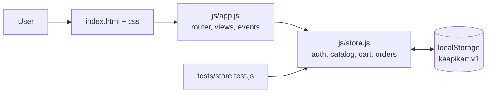
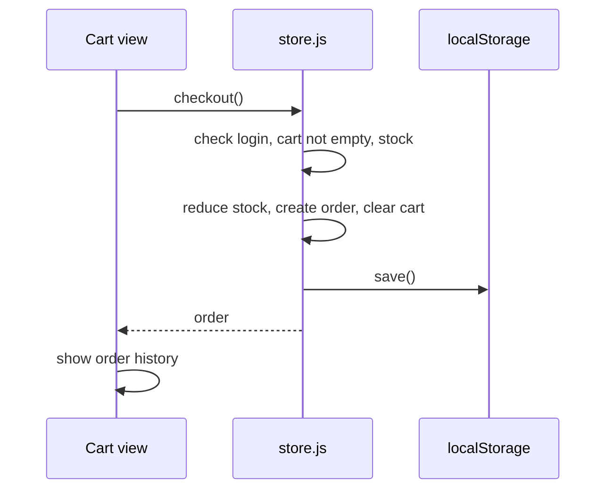

# KaapiKart ☕

A production-style storefront for South Indian filter coffee and brewing gear. Built as a capstone with **zero dependencies and no build step**: plain HTML, CSS and ES modules.

**Live demo:** `https://YOUR-SITE.netlify.app` (replace after deploying)
**Repository:** `https://github.com/YOUR-USERNAME/kaapikart`

## Features

- **Authentication simulation:** register, log in, log out, with validation and roles (`admin`, `customer`). Sessions persist across reloads.
- **Interactive catalog:** live search, category filter, sorting, product detail dialog, low-stock and sold-out states.
- **Cart and checkout:** guest cart that merges into your account on login, stock-aware quantities, order history.
- **Admin CRUD:** admins add, edit and delete products from the Manage page. Permission checks live in the data layer, not just the UI.
- **Persistent state:** everything is stored in `localStorage` and survives refreshes. Corrupt data resets safely.
- **Quality:** responsive, keyboard accessible, dark mode, reduced-motion support, HTML escaping on all user content, unit tests.

**Demo admin login:** `admin@kaapikart.dev` / `admin123`

## Architecture





| Path | Responsibility |
| --- | --- |
| `js/store.js` | All business logic and persistence. No DOM, so it is testable in Node. |
| `js/app.js` | Hash router, rendering, event delegation, toasts. |
| `css/styles.css` | Design tokens, layout, dark mode. |
| `tests/store.test.js` | Auth, catalog, permissions, cart, checkout, persistence tests. |

## Run locally

```bash
npm test        # runs unit tests (Node 18+)
npm start       # serves on http://localhost:3000
```
You can also use any static server (ES modules need `http://`, not `file://`).

## Deploy

- **Netlify:** drag the project folder onto https://app.netlify.com/drop, or connect the GitHub repo (publish directory `.`, no build command).
- **Vercel:** `npx vercel --prod`, or import the repo (framework preset "Other", no build command).
- **GitHub Pages:** push to `main`, then Settings → Pages → Source: GitHub Actions. The included workflow runs tests and deploys.
- **Cloudflare Pages:** connect the repo, leave the build command empty, output directory `/`.

## Security note

Authentication here is a **simulation**. Passwords use a demo hash in the browser, and anyone can edit `localStorage`. A real deployment moves auth, orders and product writes to a server with a database and a proper password hash (argon2 or bcrypt).

## Next steps

Backend with Postgres and JWT sessions, payment gateway, image uploads, order status workflow, end-to-end tests.

## License

MIT
